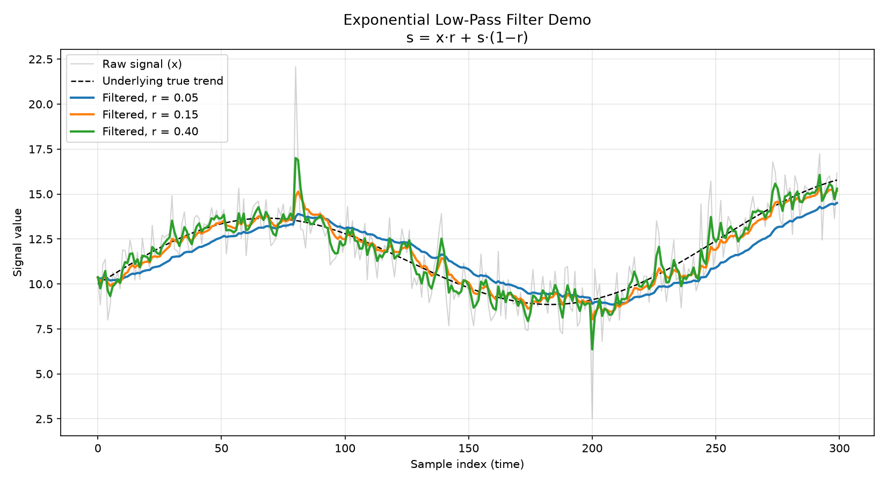

# DES222 Task 2 - Process Journal

# Prequel One
Setting up the Journal based on week 5 learning materials
---
### Record everything in raw form in a way you can revisit it...
- track what you've done
- parameters settings material
- where you found stuff
- keeper of ideas
- List and sketches
- concepts
- raw working notes process journal (Copyright)
- showing development process
- due diligence preparation and research
- notes written later don't carry the same weight...
- record everything (doesn't matter how or what format)

### Where things went wrong:
- Agonising about how to do it...
- Anxiety of presenting...
- Procrastination...
- False starts
- Technology roadblocks
- Failure of ideas

### What do i actually need to do?

### Solution:

# Prequel Two
The picture from my phone of a ship at sea, in place it shouldn't be, sailing close to the rocks - means nothing ... 😄

# Prequel Three
Added the [Youtube solution](https://christianheilmann.com/2022/09/14/quick-tip-embedding-youtube-videos-in-github-pages/) _includes folder.
The proof video is one of mine.

---
# Now the real deal...
---
---
# Entry 1 - Monday 17 August 2026
- Roughed out a concept and plan in the [README.md](/README.md) file
- This entry below updates as the README.md file is updated

# Entry 2 - Weekend of 22/23 August...

### Some notes on Accessibility: 
Guided by Australian [Disability Discrimination Act 1992](https://www.legislation.gov.au/C2004A04426/latest/text)  
#### Design for access by persons with disabilities:
  - Low vision and colour deficiency
    - Fonts >12pt and sans serif (fonts without the squiggly bits)
    - Ensure zoom up to 200% resizes page appropriately  
      (Works ~same as changing page width to slightly rearrange content)
    - If images include text -> ensure sufficient contrast  
      Use Luminance not Hue (HSV/HSL instead of RGB)
      [Colour Contrast Tool](https://portableapps.com/apps/utilities/colour-contrast-analyser-portable)
    - Ensure images have Alt text
    - Have a thought out logical heading structure in your HTML code.
    - Use H1 -> H6 in order (don't skip) 
  - Add audio descriptions for videos
    - Try [Able Player](https://ableplayer.github.io/ableplayer/) for embedded videos on your pages  
      (Closed captions are captions that can be turned on/off by the viewer)
  - Consider those with poor dexterity (Can you navigate without a mouse?)
    - Does the TAB key navigate your site in an appropriate order? And ENTER follows links?
    - Can you see a keyboard "Focus Ring"?
  - Does the site have Skip Links? "Skip to Main Content" on TAB... [this](https://css-tricks.com/how-to-create-a-skip-to-content-link/)
  - No autoplaying videos or animations and no flashing elements  
    (Implement a "pause background animation" feature)
  - Make it left justified  
  - Consider using an accessibilityy widget like [this...](https://userway.org/widget/)

# Entry 3 - Week 6
### Data smoothing example
s = x * r + s * (1 - r)  
  **Exponential low pass filter** x is the raw signal and s is the smoothed result.  
  r is the weighting for the new value (ie 5%) -> update the smoothed value by setting  
  it equal to 95% of its previous smoothed value plus 5% of the newly observed signal value.

# Entry 4 - Week 7

The WORST part... I want to produce * **something** * I am struggling so much visualising a coherent, stable vision of what * **something** * is!  
I get lost in a detail and stray from my goal with needless complexity.

I need help, I don't know how to ask - its not something I do.

### In other news...

I have made some purchases and have made some progress familiarising myself with how the **ESP32-S3** works

<table>
  <tr>
    <td></td>
    <td></td>
  </tr>
</table>
(The "trick" for side to side images to appear correctly in GitHub pages was to include the parent folder in the src= path.)  
  
I also have a breadboard, wiring, battery power supply and a number of other sensors.  

  
  

  

# Entry 5 - Week 8 preparation...

I'm not sure how to pull off a zoom presentation. I have a half complete Powerpoint but think I am better off just sharing my GitHub site ... 

# Entry 6 - The Prototype...
I've settled on an ESP32-C6 1.47inch Display Development Board, 172×320, 262K Color, 160MHz Running Frequency Single-core Processor, Supports WiFi 6 & Bluetooth, With Colorful RGB LED, ESP32 With LVGL GUI interface...
<table>
  <tr>
    <td></td>
    <td></td>
  </tr>
</table>

 
I disconnected all the sensors from the ESP32 again and will reconnect 1 by 1 this time with the software - Just like flying! If you add something new, only change 1 thing!

# Entry 7 - Consolidation of the last few weeks...
There has been a lot of wheel spinning. I have been experimenting with a number of different IDE's:
- Arduino IDE was the first one I got working
- [Thonny](https://thonny.org/) was next - It was interesting in that I used MicroPython instead of C++
    - https://gist.github.com/invisiblek
- VS Code is also working using PlatformIO

Some other projects also helped in working towards an operational prototype:
- https://github.com/thewall1963/C6
- https://github.com/merlinmb/ESP32-C6-LCD-1.47_GithubCommits
- https://github.com/AndroidCrypto/ESP32_C6_Waveshare_ST7789_Starter
- https://github.com/AndroidCrypto/TFT_eSPI

I also discovered too late, a better UV sensor, LTR190.

But in other goood news, I have now calibrated my S12SD using a few layers of plumber's thread-seal (Teflon) tape over the sensor's window. The PTFE lets UV through but spreads it and weakens it making the sensor a little less positionally dependent. I've tested it today in a range from 8.0 down to sunset and it scales reasonably closely.

<!-- 

 -->

<table>
  <tr>
    <td></td>
    <td></td>
  </tr>
</table>

The main.cpp file now runs to ~500 lines but that has a lot of changes yet to happen... but its working... and I am progressing.

# 
# Working Prototype (Entry 8)

3 sensors, 2 temperature and one UV along with a UV forecast model for the location.
<table>
  <tr>
    <td></td>
    <td></td>
  </tr>
</table>

# Entry 9
Lots of time spent fine tuning the alarms states and refining the webpage but the outcome is looking pretty good.

The README.md file for the appL 
[README.md](https://github.com/cyclonesak/KiteSafeApp/blob/main/README.md)

<h1>KiteSafe App</h1>

A wearable UV and temperature monitor for kitesurfing sessions that can also
be applied to other contexts. An ESP32-C6 reads a UV sensor and two temperature
probes, shows them on a small colour LCD, and serves a responsive, accessible
web page you can open on your phone. It warns you (or your parent or significant
other on the beach) with the display, an RGB LED, a buzzer and the web page when
conditions become dangerous.

<strong>Note:</strong> It's' not a certified safety instrument. Always check conditions
yourself.

<h2>Features</h2>

<ul>
  <li><strong>UV index</strong> from a S12SD sensor, shown on the LCD and web page using
    the Australian UV colour scale.</li>
  <li><strong>Calibration at the beach</strong> with one button press, using
    <a href="https://open-meteo.com/">Open-Meteo</a> modelled UV as the reference.</li>
  <li><strong>Two temperature probes</strong> (Internal and External) coloured by change from a
    base reading you set on the same button press.</li>
  <li><strong>Alarms</strong> for dangerous UV exposure and for a large temperature difference
    between the probes.</li>
  <li><strong>Web page</strong> served by the ESP32 itself: live readings, Open-Meteo
    reference, and Holfuy wind widgets for Golden Beach and Currimundi.</li>
</ul>

<h2>Hardware</h2>

<table>
  <thead>
    <tr><th>Part</th><th>Connection</th></tr>
  </thead>
  <tbody>
    <tr><td>ESP32-C6 DevKitC-1 with 172x320 ST7789 LCD (LVGL 9)</td><td>on board</td></tr>
    <tr><td>S12SD UV sensor</td><td>VCC to 3V3, GND to GND, SIG to <strong>GP3</strong></td></tr>
    <tr><td>2 x DS18B20 waterproof probes (parallel on one 1-Wire bus)</td><td>red to 3V3, black to GND, data to <strong>GP23</strong>, plus one 4.7 kOhm pull-up between GP23 and 3V3</td></tr>
    <tr><td>Buzzer</td><td><strong>GP2</strong></td></tr>
    <tr><td>RGB LED (on-board NeoPixel)</td><td>GPIO8</td></tr>
    <tr><td>Calibration button</td><td>on-board <strong>BOOT</strong> (GPIO9)</td></tr>
  </tbody>
</table>

<code>lv_conf.h</code> must enable <code>LV_FONT_MONTSERRAT_16</code>, <code>_28</code> and <code>_48</code> (checked at
compile time).

<h2>Setup</h2>

<ol>
  <li>Copy <code>include/secrets.h.example</code> to <code>include/secrets.h</code> and enter your Wi-Fi
    name and password. This file is git-ignored; never commit it.</li>
  <li>Build and upload with PlatformIO (<code>esp32-c6-devkitc-1</code>). Libraries
    (OneWireNg, DallasTemperature, LVGL, graphics) are fetched automatically.</li>
  <li>The device joins your Wi-Fi at boot (retrying every minute if it fails) and
    shows its status on the LCD. Open the device's IP address in a browser on the
    same network. The LCD and sensors keep working without Wi-Fi.</li>
</ol>

<h3>Measuring</h3>

<ul>
  <li>The UV sensor outputs about 0.1 V per UV index. The ADC is read every 2 s,
    averaging 64 samples.</li>
  <li>The probes are read every 5 seconds.</li>
  <li>UV and both temperatures report the <strong>peak of each 30-second window</strong>. This
    smooths noise but still catches spikes. Alarms and the web page use these
    reported peaks, except temperature colours, which use the live reading.</li>
  <li>Open-Meteo modelled UV for Happy Valley (-26.81, 153.135) is fetched every
    10 minutes (retrying after 1 minute on failure) as a secondary reference.</li>
</ul>

<h3>Calibration and base readings (BOOT button)</h3>

Stand on the beach, ready to go, and press <strong>BOOT</strong>:

<ul>
  <li><strong>UV:</strong> the sensor value is aligned to the current Open-Meteo value by an
    additive offset. From then on the device reports changes up or down from that
    point. Needs Wi-Fi and a fresh Open-Meteo value; otherwise the LCD shows
    "Cal failed".</li>
  <li><strong>Temperature:</strong> the current Internal and External readings are stored as base
    readings. This happens even if the UV step fails.</li>
  <li>The offset and bases are saved in flash and survive reboots.</li>
</ul>

The web page shows "Sensor calibration: Active (-1.2 offset)". The number is
what was added to the raw sensor reading: negative means the sensor read higher
than Open-Meteo at calibration, positive means lower.

<h3>UV colours and alerts</h3>

<table>
  <thead>
    <tr><th>Level</th><th>UV index</th><th>Colour</th></tr>
  </thead>
  <tbody>
    <tr><td>Low</td><td>1-2</td><td>#96CC00</td></tr>
    <tr><td>Moderate</td><td>3-5</td><td>#FDDC01</td></tr>
    <tr><td>High</td><td>6-7</td><td>#FE9A28</td></tr>
    <tr><td>Very high</td><td>8-10</td><td>#D8001D</td></tr>
    <tr><td>Extreme</td><td>11+</td><td>#BB00C1</td></tr>
  </tbody>
</table>

A UV alert starts when the reading is:

<ul>
  <li><strong>Extreme</strong>, immediately;</li>
  <li><strong>Very high</strong> for more than 15 continuous minutes; or</li>
  <li><strong>High</strong> for more than 45 continuous minutes.</li>
</ul>

These delays are alert triggers, not safe exposure times. The alert clears
automatically when the reading leaves the qualifying band.

<h3>Temperature colours and alarm</h3>

Each probe is grey at its base reading, shading toward orange-red as it warms
and blue as it cools (full colour at 3 °C from base). The web page also writes
the difference, for example "+1.8 °C - Warmer than base".

A <strong>temperature-gap alarm</strong> starts when the two probes differ by 10 °C or more
and clears automatically when the gap closes.

<strong><em>these are arbitary figures used in testing and will be subject to refinement
during trials.</em></strong>

<h3>Alarm outputs</h3>

<table>
  <thead>
    <tr><th>Output</th><th>Behaviour</th></tr>
  </thead>
  <tbody>
    <tr><td>LCD</td><td>Alert message with the UV colour. If UV and temperature alarms are both active, the message alternates every 3 s.</td></tr>
    <tr><td>RGB LED</td><td>Flashes (250 ms on/off) in the UV level colour, or red for a temperature alarm. Otherwise shows the current UV colour steadily.</td></tr>
    <tr><td>Buzzer (GP2)</td><td>2.4 kHz double beep every 2 s.</td></tr>
    <tr><td>Web page</td><td>Static, high-contrast warning banner (no flashing) and an optional 10-second beep.</td></tr>
  </tbody>
</table>

<h3>Web page</h3>

The page is <code>data/index.html</code>, embedded in the firmware during the normal
PlatformIO build by <code>scripts/embed_web.py</code> (it generates <code>web_page.h</code>). Edit the
HTML, then build and upload as usual; no filesystem upload is needed.

<ul>
  <li>The page polls <code>sensor.json</code> from the device every 15 s. It must be opened from
    the device's IP address for live data; opened from disk it shows no sensor
    readings.</li>
  <li><code>/sensor.json</code> provides: <code>ok</code>, <code>uv</code>, <code>mv</code>, <code>age_ms</code>, <code>alert</code>
    (<code>none</code>/<code>high</code>/<code>very_high</code>/<code>extreme</code>), <code>calibrated</code>, <code>offset</code>, <code>temp_alarm</code>,
    and per-probe <code>name</code>, <code>c</code> (30 s peak), <code>now</code> (live) and <code>base</code>. Values may be
    null.</li>
  <li>The browser fetches Open-Meteo directly, and the Holfuy widgets load from
    Holfuy, so those parts need internet on the viewing device.</li>
  <li><strong>Alarm sound:</strong> browsers block sound until you interact, so press "Alarm
    sound: Off" once to turn it on. A new alarm then plays five double-beeps over
    10 seconds.</li>
</ul>

<h3>Accessibility</h3>

Responsive layout that reflows for screen size, rotation and 200% zoom; 18 px
sans-serif system fonts; skip link; ordered headings; visible focus ring;
full keyboard operation; 44 px minimum targets; colour always paired with text;
no animation or flashing; light and dark modes. I tried to make the page "accessible" through a waterproof phone case and water droplets...

<h2>Files</h2>

<table>
  <thead>
    <tr><th>Path</th><th>Purpose</th></tr>
  </thead>
  <tbody>
    <tr><td><code>src/main.cpp</code></td><td>Firmware: sensors, display, alerts, web server</td></tr>
    <tr><td><code>data/index.html</code></td><td>Web page source</td></tr>
    <tr><td><code>scripts/embed_web.py</code></td><td>Build step that embeds the page in firmware</td></tr>
    <tr><td><code>include/secrets.h.example</code></td><td>Wi-Fi credentials template</td></tr>
    <tr><td><code>platformio.ini</code></td><td>Board, libraries, build settings</td></tr>
  </tbody>
</table>

# Entry 10 Marketing

    <h2>Project Intro Video</h2>
    <video controls style="width:100%; max-width:900px; ">
        <source src="/2026_DES222_Process_Journal/images/IntroVideo.mp4" type="video/mp4">
        Your browser does not support HTML5 video.
    </video>

I LOVE this use of AI. It relieves me of the trauma of being in front of a camera ㋡

# Entry 11 Sea trials went well ... NOT!

Wasn't even my dodgey attempts to waterproof the device - this is my Samsung S25 mobile phone that was in the commercially sold supposedly waterproof case under my wetsuit ☹

# Entry 12 Getting the model set to wear

The buzzer alarm speaker is sitting upright on its side - I tried laying it flat but I need a bit of air space in there so it doesn't get too muted under the waterproof layer.

I had to remove a few layers of the teflon wrap to account for the waterproof covering. Trial and error got me close to the predicted reading. 

The absolute best thing I've done for the sensors reading is the calibration button. I remapped one of the buttons on the device to "zero" the UV index reading against the model forecast - the idea is you get to your site, setup all your gear, then just as you're about to go out, while you're standing on the beach in the sun, press the calibrate button and it sets the current reading at whatever the model says. It then rises and falls as per local readings along with the math for when the "too much exposure" alarm goes off. The calibrate button also sets the colour readings for the temperature sensors. The internal and external sensors start as a neutral colour - they scale to red (hot) as the reading increases and blue (cold) as it decreases.  

